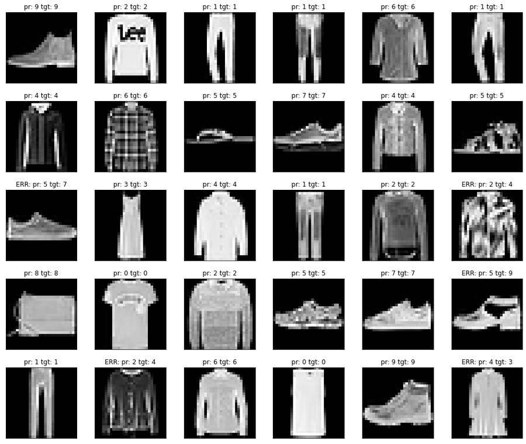
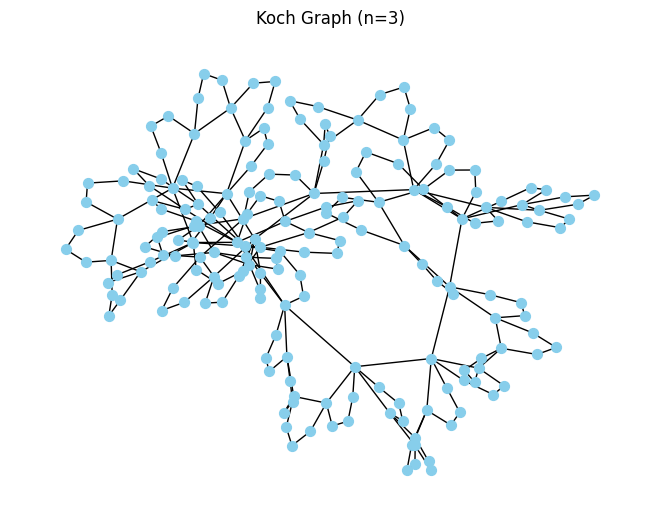
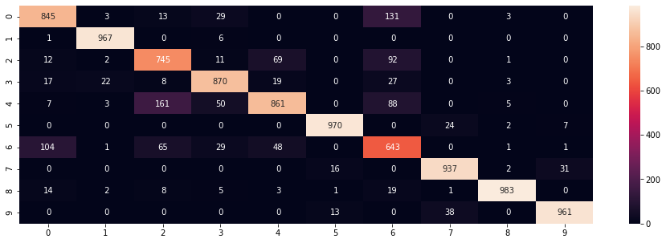
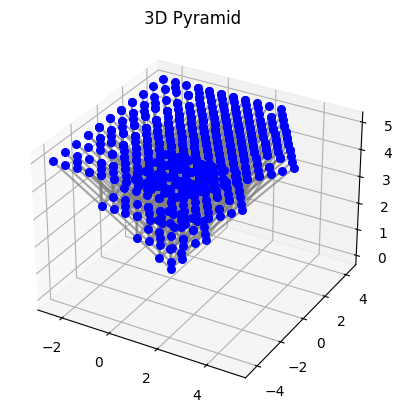

<div align="center">

# Python · Data · ML

**Нейросети на PyTorch, оптимизация Python-кода и обработка больших данных на Dask**


</div>

---

Учебные и исследовательские ноутбуки: от нейрона, собранного вручную на тензорах, до сверточных сетей, transfer learning и распределённой обработки данных. Каждый ноутбук можно открыть в Google Colab в один клик.

<p align="center">
  
  
</p>

## Содержание

### 01 · Deep Learning

| Ноутбук | Что внутри | |
|---|---|---|
| [nn-from-scratch-backprop](01-deep-learning/nn-from-scratch-backprop.ipynb) | Нейрон, полносвязный слой, ReLU / softmax / ELU, MSE и cross-entropy, L2-регуляризация и обратное распространение ошибки, написанные вручную на тензорах PyTorch, SGD и пакетный градиентный спуск | [](https://colab.research.google.com/github/cent0n1y/python-data-ml/blob/main/01-deep-learning/nn-from-scratch-backprop.ipynb) |
| [cnn-image-classification](01-deep-learning/cnn-image-classification.ipynb) | Классификация Fashion-MNIST и CIFAR-10 полносвязными и сверточными сетями, свои датасеты из архивов, transfer learning на VGG16, матрицы ошибок | [](https://colab.research.google.com/github/cent0n1y/python-data-ml/blob/main/01-deep-learning/cnn-image-classification.ipynb) |

### 02 · Performance

| Ноутбук | Что внутри | |
|---|---|---|
| [profiling-vectorization-numba](02-performance/profiling-vectorization-numba.ipynb) | Профилирование (`line_profiler`), векторизация NumPy / pandas и ускорение циклов через Numba со сравнением времени | [](https://colab.research.google.com/github/cent0n1y/python-data-ml/blob/main/02-performance/profiling-vectorization-numba.ipynb) |
| [multiprocessing](02-performance/multiprocessing.ipynb) | Параллельные вычисления на `multiprocessing`: частотный анализ текста и обработка CSV в несколько процессов | [](https://colab.research.google.com/github/cent0n1y/python-data-ml/blob/main/02-performance/multiprocessing.ipynb) |

### 03 · Big Data · Dask

| Ноутбук | Что внутри | |
|---|---|---|
| [dask-array](03-big-data-dask/dask-array.ipynb) | Массивы, которые не помещаются в память: чанки, ленивые вычисления, HDF5 | [](https://colab.research.google.com/github/cent0n1y/python-data-ml/blob/main/03-big-data-dask/dask-array.ipynb) |
| [dask-bag-mapreduce](03-big-data-dask/dask-bag-mapreduce.ipynb) | Map-Reduce на Dask Bag: разбор текста и JSON | [](https://colab.research.google.com/github/cent0n1y/python-data-ml/blob/main/03-big-data-dask/dask-bag-mapreduce.ipynb) |
| [dask-dataframe](03-big-data-dask/dask-dataframe.ipynb) | Датафреймы на множестве файлов: пропуски, группировки, агрегаты | [](https://colab.research.google.com/github/cent0n1y/python-data-ml/blob/main/03-big-data-dask/dask-dataframe.ipynb) |
| [dask-delayed](03-big-data-dask/dask-delayed.ipynb) | Параллельные пайплайны на `dask.delayed`: архивы, парсинг HTML (BeautifulSoup) | [](https://colab.research.google.com/github/cent0n1y/python-data-ml/blob/main/03-big-data-dask/dask-delayed.ipynb) |

### 04 · Databases

| Ноутбук | Что внутри | |
|---|---|---|
| [sqlite-pandas](04-databases/sqlite-pandas.ipynb) | SQL-запросы к базе Chinook через `sqlite3`, выгрузка в pandas и CSV | [](https://colab.research.google.com/github/cent0n1y/python-data-ml/blob/main/04-databases/sqlite-pandas.ipynb) |

### 05 · Fractal Graphs

| Ноутбук | Что внутри | |
|---|---|---|
| [fractal-graphs](05-fractal-graphs/fractal-graphs.ipynb) | Рекурсивная генерация графов на NetworkX: граф Коха, фрактальное дерево, 3D-пирамида и распределения степеней вершин | [](https://colab.research.google.com/github/cent0n1y/python-data-ml/blob/main/05-fractal-graphs/fractal-graphs.ipynb) |
| [graph-basics](05-fractal-graphs/graph-basics.ipynb) | Ориентированный граф и его визуализация | [](https://colab.research.google.com/github/cent0n1y/python-data-ml/blob/main/05-fractal-graphs/graph-basics.ipynb) |

<p align="center">
  
  
</p>

## Запуск локально

```bash
pip install torch torchvision numpy pandas matplotlib seaborn scikit-learn numba line_profiler "dask[complete]" h5py networkx beautifulsoup4 nltk
jupyter lab
```

Датасеты для заданий с собственными изображениями лежат на Яндекс Диске, ссылки указаны внутри ноутбука.

---

<p align="center"><sub>part of <a href="https://github.com/cent0n1y">cent0n1y</a> · 01</sub></p>
